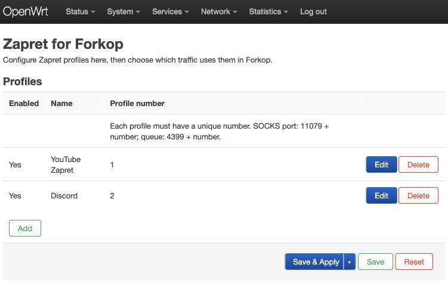
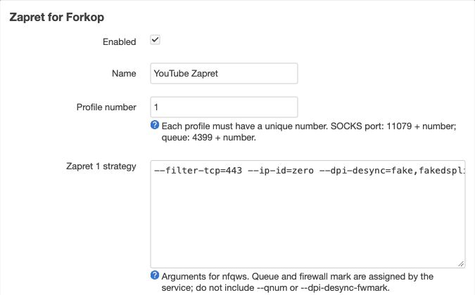

# Zapret for Forkop

Experimental OpenWrt application for creating Zapret 1 profiles and routing
selected traffic to them from Forkop. **Experimental**: installed and tested on one Cudy TR3000 router, including
LuCI apply, firewall reload and reboot. Wider deployment still requires careful
validation and a rollback plan.

Forkop chooses traffic and connects to a per-profile loopback SOCKS5 endpoint.
A Rust bridge relays TCP and UDP with profile-specific Linux socket marks; the
profile's nfqws instance processes marked packets. There is no second
sing-box instance.

The LuCI view edits profile names, slots and nfqws arguments and shows a SOCKS
outbound JSON with the required Forkop tag. Adding that JSON to a Forkop
connection section and choosing routing rules is currently manual. The
experimental procd manager validates nfqws arguments and nftables, checks
listener and queue ownership, starts instances and attempts rollback on
application errors. Details and limitations: [OpenWrt profiles](docs/openwrt-profiles.md).

## Screenshots

Profile list in LuCI:



Strategy editor:



## Current limitations

- The old forkop-zapret-bridge is retained on the test router as a rollback
  option. Do not run both services at once: their queues and marks overlap.
- DoH upstreams are hard-coded (Google, with Cloudflare as fallback) and
  domain resolution is IPv4 only. SOCKS UDP IPv6
  is not implemented. No unauthenticated listener may bind outside loopback.
- The tested router has a firewall include and sysupgrade keep list. Installer
  rollback is best effort and late service failures may need manual recovery.
  Readiness checks do not guarantee working traffic or prevent later crashes.
- A saved profile does not imply a running, healthy profile.

## Development

```sh
cargo test --offline
cargo clippy --offline --all-targets -- -D warnings
cargo build --offline
python3 tests/socks_smoke.py
for test in tests/profile/test_*.sh; do sh "$test"; done
node tests/profile/test_luci.js
sh tests/installer/test_install.sh target/aarch64-unknown-linux-musl/release/zapret-forkop
```

The installer test needs an AArch64 binary (see below); it only checks its ELF
header, so the files are installed into a temporary root.

For cross-compilation, install the Rust `aarch64-unknown-linux-musl` target and
Zig, then run `scripts/build-openwrt.sh`. Set `ZIG` and `CARGO` when needed.

On the Cudy router, an isolated ARM64 Rust binary passed DoH and HTTPS tests.
YouTube and Discord HTTPS requests through the Rust bridge and the **existing**
nfqws queues returned HTTP 200 and incremented the respective nft counters.
A separately named test copy of the new service passed start, reload, invalid reload, stop, and a YouTube HTTPS test on the router. On the same router, profile Save & Apply, firewall reload and reboot were also checked with the new service. Discord voice and QUIC remain unverified on-device.

## GitHub Actions and releases

Pull requests and pushes to `main` run the Rust, SOCKS TCP/UDP, LuCI and
installer checks; Actions then builds an OpenWrt AArch64 archive and its
SHA-256 checksum, available as run artifacts. Pushing a tag such as `v0.1.0`
that matches the version in Cargo.toml creates a GitHub Release with the
archive and SHA256SUMS after the checks pass.

The archive is a tar.gz with an installer, not an apk/ipk package. It targets
OpenWrt AArch64; Zapret 1 `nfqws` and strategy files must be installed
separately. The application remains experimental: see the limitations above
and INSTALL.md in the archive.
